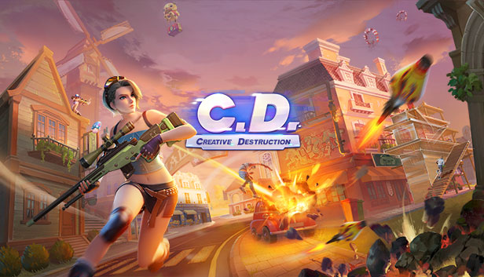

<div align="center">

# 💥 Creative Destruction Reborn

**Rejoue à Creative Destruction PC, hors ligne, sur ton propre ordinateur.**<br>
*Play Creative Destruction PC again, offline, on your own computer.*


### [⬇️ Télécharger / Download](https://github.com/crasyimperior/creative-destruction-reborn/releases/latest)

[🇫🇷 Français](#-français) · [🇬🇧 English](#-english)



</div>

> [!IMPORTANT]
> Ce dépôt ne contient **aucun fichier du jeu**. C'est un petit serveur local + un mod client à installer
> dans **ta propre copie** du jeu PC officiel (serveurs fermés en juin 2022).<br>
> *This repository contains **no game files**: a small local server + a client mod for **your own copy** of the game.*

---

## 🇫🇷 Français

### 📋 Ce qu'il faut

| | |
|---|---|
| 🎮 **Le jeu** | Creative Destruction PC officiel, version `3.0.210.0` (le dossier avec `client.exe` et `script.npk`) |
| 🐍 **Python 3.8+** | <https://www.python.org/downloads/> — coche **« Add python.exe to PATH »** |
| 🌐 **Internet** | Uniquement pendant l'installation (téléchargement de `pycryptodome`) |

<details>
<summary>🔍 <b>Vérifier ta copie du jeu</b></summary>
<br>

Le jeu n'est plus distribué officiellement. Si tu as gardé ton installation, vérifie que c'est la bonne version
(dans PowerShell : `Get-FileHash <fichier>`) :

| Fichier | SHA-256 |
|---|---|
| zip de l'installateur du jeu | `3f5008c3c3c953f005dbb3681b2a24ae4abd71199435c8948b60fb7173a17be5` |
| `script.npk` (15 607 644 octets) | `f47bcc7cbb261897072a53af269fc839a54e7cfada9d9a0268d8b7165b1738e1` |

</details>

### 🛠️ Installation

**1.** Décompresse l'archive **dans le dossier du jeu**, à côté de `client.exe` :

```
📁 Creative Destruction\
 ├─ client.exe
 ├─ script.npk
 ├─ ...
 ├─ 📁 reborn\
 ├─ Installer - Install.bat
 ├─ Lancer hors ligne - Play Offline.bat
 ├─ Desinstaller - Uninstall.bat
 └─ README.md
```

**2.** Double-clique sur **`Installer - Install.bat`**.
Il désactive la mise à jour du jeu (erreur 902) et installe le mod dans `Documents\`.
Les fichiers d'origine sont sauvegardés dans `reborn\backup\`.

### 🎮 Jouer

**1.** Double-clique sur **`Lancer hors ligne - Play Offline.bat`** : le serveur (fenêtre noire réduite) puis le jeu s'ouvrent.

> [!WARNING]
> Ne ferme pas et **ne clique pas** dans la fenêtre du serveur pendant que tu joues.

**2.** Dans le jeu : **Confirmer** → **Jouer**. Crée ton personnage si on te le demande.

**3.** Pour une partie : **Lancer** → tu arrives sur l'île de départ.
Ouvre la console, tape `start` puis <kbd>Entrée</kbd> :
compte à rebours → présentation des joueurs → bus → saut 🪂

> [!TIP]
> **⌨️ Console** : appuie sur <kbd>²</kbd> (la touche sous <kbd>Échap</kbd>, clavier AZERTY).
> Sur certains claviers (QWERTY…), c'est la touche <kbd>~</kbd>.

### ✅ Ce qui fonctionne

- 🔓 Connexion sans compte NetEase, lobby, profil, changement de pseudo
- 💎 999 999 999 diamants / or / étoiles, **tous les skins et objets débloqués**
- 👕 Équiper tenues et skins, bouton ♂/♀ dans le profil pour changer de personnage
- 🪂 Partie : île de départ, compte à rebours, présentation, bus, saut en parachute, pioche

### 🗺️ Prévu pour la suite

| | Fonctionnalité | Description |
|:-:|---|---|
| 🤖 | **Bots** | Adversaires contrôlés par le serveur qui se déplacent, ramassent du butin et attaquent |
| 🏆 | **Vraie partie battle royale** | Contre des bots, du bus jusqu'au dernier survivant, avec écran de victoire |
| 🎁 | **Butin au sol** | Armes, munitions, soins et matériaux répartis sur la carte |
| 🔫 | **Armes et dégâts** | Tir, points de vie, armure, éliminations |
| 🌪️ | **Zone** | Qui se resserre pendant la partie |
| 🧱 | **Construction** | Gérée par le serveur |

<sub>Pas prévu pour l'instant : amis, classement, boutique (inutile : tout est déjà débloqué).</sub>

### 🗑️ Désinstaller

Double-clique sur **`Desinstaller - Uninstall.bat`** : les fichiers d'origine du jeu sont restaurés.
Tu peux ensuite supprimer le dossier `reborn` et les fichiers `.bat`.

<details>
<summary>❓ <b>Problèmes fréquents</b></summary>
<br>

| Problème | Solution |
|---|---|
| « Python 3 est requis » | Installe Python et coche « Add python.exe to PATH », puis relance l'installation. |
| Le jeu reste sur « Connexion... » | Le serveur n'est pas lancé : utilise toujours `Lancer hors ligne - Play Offline.bat`. |
| « Connexion perdue » en partie | Tu as cliqué dans la fenêtre du serveur (ça la met en pause). Ne clique pas dedans. |
| Erreur 902 au lancement | Relance `Installer - Install.bat`. |

📁 Tes données (pseudo, équipement) : `reborn\server\save\player.json`<br>
📄 Journaux : `reborn\server\logs\` et `Documents\offline_mod.log`

</details>

---

## 🇬🇧 English

### 📋 Requirements

| | |
|---|---|
| 🎮 **The game** | Official Creative Destruction PC, version `3.0.210.0` (the folder with `client.exe` and `script.npk`) |
| 🐍 **Python 3.8+** | <https://www.python.org/downloads/> — tick **"Add python.exe to PATH"** |
| 🌐 **Internet** | Only during install (downloads `pycryptodome`) |

<details>
<summary>🔍 <b>Check your copy of the game</b></summary>
<br>

The game is no longer officially distributed. If you kept your installation, check it is the right version
(in PowerShell: `Get-FileHash <file>`):

| File | SHA-256 |
|---|---|
| game installer zip | `3f5008c3c3c953f005dbb3681b2a24ae4abd71199435c8948b60fb7173a17be5` |
| `script.npk` (15,607,644 bytes) | `f47bcc7cbb261897072a53af269fc839a54e7cfada9d9a0268d8b7165b1738e1` |

</details>

### 🛠️ Install

**1.** Extract the archive **into the game folder**, next to `client.exe` (see the layout above).

**2.** Double-click **`Installer - Install.bat`**.
It disables the game's update check (error 902) and installs the mod into `Documents\`.
The original files are backed up into `reborn\backup\`.

### 🎮 Play

**1.** Double-click **`Lancer hors ligne - Play Offline.bat`**: the server (minimized black window) then the game open.

> [!WARNING]
> Do not close the server window and **do not click inside it** while playing.

**2.** In game: **Confirm** → **Play**. Create your character if asked.

**3.** For a match: **Start** → you land on the starting island.
Open the console, type `start` then <kbd>Enter</kbd>:
countdown → players presentation → bus → jump 🪂

> [!TIP]
> **⌨️ Console**: press <kbd>~</kbd> (the key under <kbd>Esc</kbd> on QWERTY keyboards).
> On AZERTY keyboards it is the <kbd>²</kbd> key.

### ✅ Working

- 🔓 Login without a NetEase account, lobby, profile, rename
- 💎 999,999,999 diamonds / gold / stars, **every skin and item unlocked**
- 👕 Equip outfits and skins, ♂/♀ button on the profile page to switch character
- 🪂 Match: starting island, countdown, presentation, bus, parachute jump, pickaxe

### 🗺️ Planned

| | Feature | Description |
|:-:|---|---|
| 🤖 | **Bots** | Server-controlled opponents that move around, pick up loot and fight |
| 🏆 | **Real battle royale match** | Against bots, from the bus to the last one standing, with a victory screen |
| 🎁 | **Ground loot** | Weapons, ammo, heals and materials spread across the map |
| 🔫 | **Weapons and damage** | Shooting, health, armor, eliminations |
| 🌪️ | **Storm** | Shrinking during the match |
| 🧱 | **Building** | Handled by the server |

<sub>Not planned for now: friends, leaderboards, shop (useless anyway: everything is unlocked).</sub>

### 🗑️ Uninstall

Double-click **`Desinstaller - Uninstall.bat`**: the original game files are restored.
Then you can delete the `reborn` folder and the `.bat` files.

<details>
<summary>❓ <b>Troubleshooting</b></summary>
<br>

| Problem | Fix |
|---|---|
| "Python 3 is required" | Install Python with "Add python.exe to PATH" ticked, then run the installer again. |
| Stuck on "Connecting..." | The server is not running: always start with `Lancer hors ligne - Play Offline.bat`. |
| "Connection lost" in a match | You clicked inside the server window (it pauses it). Don't click in it. |
| Error 902 at startup | Run `Installer - Install.bat` again. |

📁 Your data (name, equipment): `reborn\server\save\player.json`<br>
📄 Logs: `reborn\server\logs\` and `Documents\offline_mod.log`

</details>

---

<details>
<summary>📦 <b>Contents</b></summary>
<br>

| Path | What |
|---|---|
| `reborn/server/` | local login / game / battle server (Python 3) |
| `reborn/server/data/protocol.json` | network message layouts (ids and field types) |
| `reborn/server/data/items.json` | item ids and types (used to unlock everything) |
| `reborn/client_mod/switches.nxs` | compiled client mod (source in `client_mod/src/switches.py`) |
| `reborn/client_mod/annoucement.txt` | the welcome message |
| `reborn/tools/install.py` | installer / uninstaller |

</details>

<div align="center">
<br>
<sub>❤️ Projet de fans pour la préservation du jeu, non affilié à NetEase. Il te faut ta propre copie du jeu.<br>
Fan project for game preservation, not affiliated with NetEase. You need your own copy of the game.</sub>
</div>
